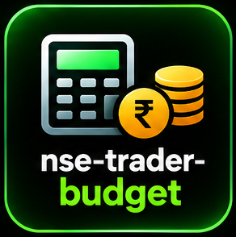

# nse-trader-budget

<p align="center"></p>

Turns a plan into a concrete quantity. It finds the **largest whole-share**
(cash) or **whole-lot** (F&O) size that fits every limit with estimated charges
inside max loss. The default `generic` profile assumes Rs 20 brokerage per
executed order. Use `--broker groww` or `--broker-profile my-broker.json` for a
different brokerage rule. Statutory/exchange estimates remain explicit.
Nothing is placed.

A stop too far away for the max loss is a **plain refusal**, not a smaller
order that quietly breaks your risk rule.

## Run it

```bash
python scripts/budget.py --capital 50000 --max-loss 500 \
  --broker generic --plan nse-trader/plan.json
```

```
ORDER  RELIANCE  BUY ... shares @ 1452.50 stop 1448.50 target 1460.50
  round-trip chg : ...
  charge profile : generic-flat-20
  saved          : nse-trader/orders.json
```

F&O:

```bash
python scripts/budget.py --segment FNO --instrument FUTURE \
  --capital 200000 --max-loss 3000 \
  --plan nse-trader/plan.json   # lot size from NSE fo_mktlots, margin est. 15%
```

Long option (exact contract symbol in the plan; give its underlying for lot
lookup, or pass `--lot-size`):

```bash
python scripts/budget.py --segment FNO --instrument OPTION --underlying NIFTY \
  --capital 100000 --max-loss 2500 --plan nse-trader/plan.json
```

For a long option the full premium is the capital requirement. Naked/short
options are intentionally unsupported because a stop-premium distance does not
bound gap, assignment or short-gamma risk.

## Limits it respects

| Limit | Flag | Default |
|---|---|---|
| Max loss per trade (incl. charges) | `--max-loss` | required |
| Max order value | `--max-order` | none |
| Max % of capital per position | `--max-position-pct` | 25% |
| Cash kept unused | `--cash-buffer` | 0 |
| Futures margin estimate | `--margin-pct` | 15% of notional |
| Long-option capital | automatic | 100% of premium + entry charges |
| Brokerage profile | `--broker` | `generic` |
| Custom brokerage | `--broker-profile` | none |

It reports **which limit decided** the size (`max_loss`, `max_order`,
`position_pct`, `capital`). For F&O it refuses if one lot's margin or stop risk
cannot fit, and tells you which number failed.

## Files

| File | What |
|---|---|
| `nse-trader/plan.json` | read: entry, stop, target, product |
| `nse-trader/orders.json` | written: qty/lots, charges breakdown, max_loss_at_stop, decided_by |

## Example session

1. Plan for RELIANCE: entry 1452.50, stop 1448.50, target 1460.50.
2. `budget.py --capital 50000 --max-loss 500 --broker generic` → a whole-share
   size, estimated round-trip charges, max loss and the binding limit.
3. `nse-trader-risk` next: it re-checks the ticket, then `nse-trader-broker`
   writes portable JSON and a human ticket.

The default generic profile is an explicit Rs 20 placeholder, not a claim about
your broker or a guaranteed upper bound. The optional Groww profile captures its published 2026 schedule.
Futures STT is estimated at 0.05% on sell, options STT 0.15% of sell premium, NSE
transaction charges 0.00173% futures / 0.03503% option premium, applicable
stamp duty, SEBI/IPFT and GST. See `references/broker-profiles.md`; your broker's
contract note is the source of truth. Not financial advice.
