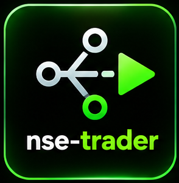

# NSE Trader

<p align="center"></p>

Route an Indian-market request to the smallest safe workflow. All times are
IST, prices are INR, primary exchange data is NSE, and every broker handoff is manual.
Never imply that any script places an order.

## First determine the intent

| User goal | Load and use |
|---|---|
| “Analyze the Indian market today” | `nse-trader-market` |
| Explain the market score in depth | `nse-trader-market`, then `nse-trader-flows` if needed |
| Find stocks to watch | `nse-trader-scanner` |
| Explain a move or check catalysts | `nse-trader-news` |
| Review company results | `nse-trader-analyst` |
| Check FII/DII or large deals | `nse-trader-flows` |
| Time an opening-range entry | `nse-trader-entry` |
| Set stop and target | `nse-trader-exit` |
| Replay or simulate a plan | `nse-trader-timemachine` |
| Calculate shares or lots | `nse-trader-budget` |
| Decide whether a ticket breaks limits | `nse-trader-risk` |
| Prepare a broker-neutral ticket | `nse-trader-broker` only after risk PASS |
| Watch stop, target, open or flat-by | `nse-trader-alerts` |

Load the selected skill by exact ID before following its workflow.

## Daily-market workflow

For “analyze the market today”:

1. Load `nse-trader-market` for index trend, Nifty breadth, India VIX, sector
   rotation, FII/DII flow, score, confidence, and a dated snapshot label.
2. Explain the score components and any missing/partial data. It is context,
   not a forecast or trade instruction.
3. If the user wants stock candidates, load `nse-trader-scanner`. During market
   hours, optionally run its intraday opening-range scan.
4. For detailed bulk/block and delivery activity, load `nse-trader-flows`.
5. If the user wants specific catalysts, load `nse-trader-news` for only the
   selected tickers.
6. Present context or a watchlist—not buy/sell commands.

If the market is closed, state the exact data/session date and call the result
a last-completed-session review rather than live analysis.

## Trade-planning workflow

```text
market → scanner → news → entry → exit → timemachine → budget → risk
        → manual broker ticket → alerts
```

Do not skip `nse-trader-exit`, `nse-trader-budget`, or `nse-trader-risk` before
the broker ticket. A BLOCK verdict ends the workflow; do not work around it.

## F&O boundary

- supported: long futures and long calls/puts
- use official NSE lot-size data and the exact contract symbol
- long-option capital is full premium plus estimated charges
- unsupported: naked/short options, multi-leg payoff modeling and automatic
  broker execution
- the selected broker’s displayed margin and contract note are authoritative

## Workspace

Run from a dedicated folder, for example `D:\nse-trading`. Skills write state
under `./nse-trader/` (or `NSE_TRADER_STATE_DIR`). Do not run them inside this
skill pack or an unrelated source repository.

## Data and safety language

- Yahoo chart data can be delayed; confirm prices in your broker/exchange view.
- NSE endpoints and Screener.in can change or be temporarily unavailable.
- State the source date and any source failures.
- Never request or display broker credentials.
- The default ticket is portable JSON/Markdown. Optional broker-specific text
  is illustrative and is never executed by this pack.
- Educational tooling only; not financial advice.
